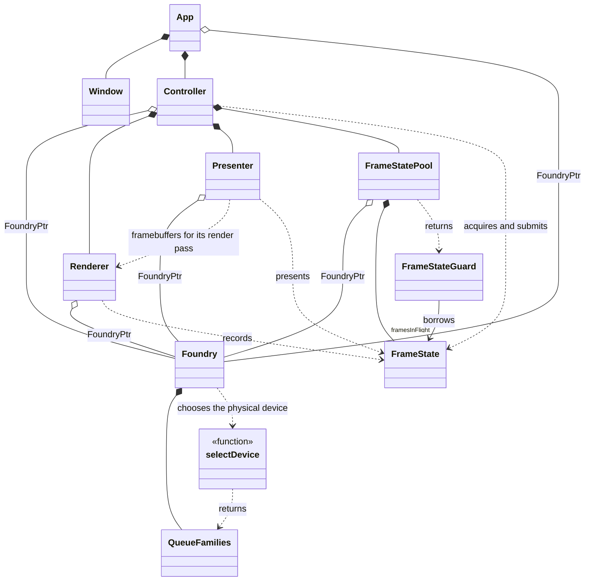
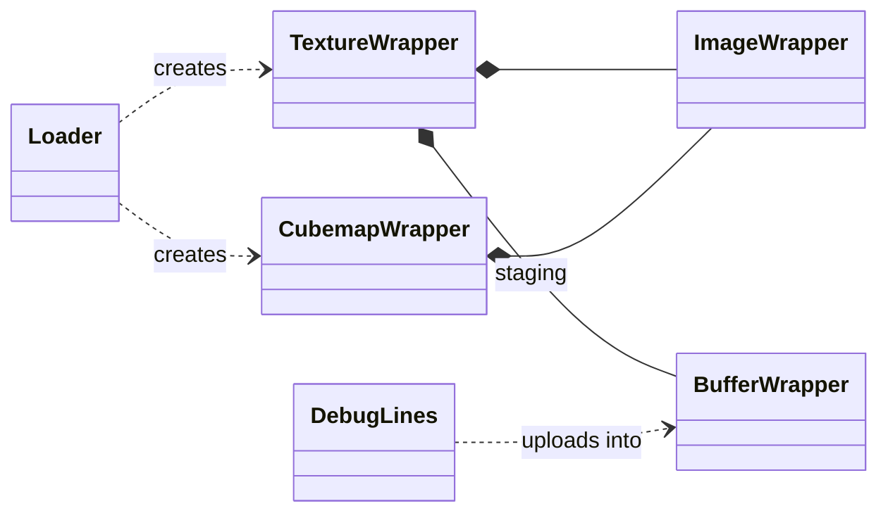

# Spock

## Design Goals

- Allow rapid iteration: minimal setup for new projects, runtime shader compilation.
- Cross platform: Linux, Windows and MacOS currently supported.
- Thin abstraction: use Vulkan_Hpp RAII to simplify Vulkan API but not hide it.

## Architectural Overview

`Spock` is organized as a layered rendering framework rather than a single monolithic engine. The reusable framework code lives under `spock/`, while example applications live under `samples/` and a smaller geometry-focused utility library lives under `geo/`.

I hope that this structure makes the project easier to use: the framework is intended to lower the barriers entry to Vulkan, especially around areas that can be complicated such as device selection and frame synchronisation.  The Vulkan_Hpp RAII wrappers have helped me greatly, and I have tried to keep them accessible whereever possible.

Each of the samples demonstrates a focused use case such as a spinning cube, instancing, shader hot-reloading and applying textures.  I am currently working through more complex examples such as Gaussian splatting and will add more.

### Core classes

The framework is built around a handful of classes, each owning one part of the Vulkan lifecycle:

- `App` — owns the `vk::raii::Context` and `vk::raii::Instance`, the `Window`, the `Foundry` and the `Controller`. `run()` drives a fixed-timestep main loop: poll events, call `update()`, render a frame, then detect window resizes and tell the controller to rebuild. Subclasses implement `createRenderer(colorFormat, framesInFlight)` and `update()`, and can override `createFoundry()` to request extra queues, extensions or device features. `renderer<T>()` returns the renderer as the subclass's own type.
- `Window` — owns the platform window, its Vulkan surface and its input state (cursor, mouse buttons, scroll wheel). The surface lives exactly as long as the window, so the `Foundry` and `Controller` only borrow it. GLFW is an implementation detail confined to `window.cpp`.
- `Foundry` — owns the physical device, logical device, queues (graphics, present, compute, transfer, and video decode when requested) and their command pools, and creates swapchains for a surface. It is given the window's surface only to choose a device that can present to it, and doesn't keep it, so the surface can be replaced without losing the device. It delegates the choice of physical device to `selectDevice()` and keeps the resulting `QueueFamilies`, which record the family index used for each queue, along with the device extensions it enabled.
- `selectDevice()` — used by the `Foundry` to enumerate physical devices and select the best one that meets the required extensions.  It returns the winning `vk::raii::PhysicalDevice` and its `QueueFamilies`.
- `Controller` — owns the `Renderer`, the `Presenter` and the `FrameStatePool`, destroying the frames first and the renderer last. `renderFrame()` runs the frame loop and submits each frame to the graphics queue. `resizeWindow()` replaces the `Presenter` at the new extent and keeps the renderer and the frames in flight. `releaseSurface()` destroys the `Presenter` so the surface can be destroyed, and `setSurface()` builds one on a new surface, keeping the device, renderer, pipelines, buffers and frames; this is what an Android app needs when its window goes away and comes back.
- `Renderer` — owns the render pass, built once for the color and depth formats so it outlives any one swapchain, and the subclass's scene resources such as pipelines and buffers. `recordFrame()` calls the virtual `prepare(FrameState&)` for the subclass to record anything that must come before the render pass, such as layout transitions, then begins the render pass, sets the viewport and scissor, and calls the pure virtual `render(FrameState&)` for the subclass to record its draw commands.
- `Presenter` — one per swapchain: owns the swapchain, its image views, the depth buffer, the framebuffers for the renderer's render pass and the per-image render-finished semaphores. Its constructor builds all of them and its destructor frees them, so a resize replaces the whole `Presenter`. `acquireFrame()` acquires an image, `acquireWait()` and `renderSignal()` give the semaphores the frame's submission must wait on and signal, and `present()` presents the image. The swapchain is created with the surface's current transform, so the presentation engine doesn't rotate the images; `preTransform()` returns it, and the renderer must rotate its output to match.
- `FrameState` - the set of per-frame resources (command buffer, acquire semaphore and timeline semaphore) for one frame in flight.  A renderer can add semaphores to wait on or signal, to synchronize with other queues.  To extend, subclass and add per-frame resources such as dynamic vertex buffers or descriptor sets.
- `FrameStatePool` - owns a fixed array of `FrameState` and rotates through them as the frames are rendered; `acquireFrame()` waits on the frame's timeline semaphore so the CPU never touches resources that the GPU is still using.
- `FrameStateGuard` - returns the `FrameState` to the pool when it goes out of scope, even if recording throws.



### Frame lifecycle

Each iteration of `App::run()` does the following:

1. `Window::pollEvents()` and `App::update()` (the subclass updates its simulation and camera).
2. `Controller::renderFrame()` lazily creates the `FrameStatePool` on the first frame, then borrows the next `FrameState`, waiting on its timeline semaphore.
3. `Presenter::acquireFrame()` acquires the next swapchain image, signalling the frame's semaphore.
4. The `Controller` calls `frame.commandBuffer.begin({})`, then `Renderer::recordFrame()` calls `prepare(frame)` to record commands outside the render pass. A `RenderPassWrapper` scopes the render pass into the `Presenter`'s framebuffer for the image; the viewport and scissor are set from the swapchain extent, and `render(frame)` records the subclass's commands. The `Controller` then calls `frame.commandBuffer.end()`. If recording throws, the `Controller` abandons the frame: an empty submission consumes its acquire semaphore and advances its timeline, so the frame can be used again, and the error propagates.
5. `Controller::submit()` submits the command buffer to the graphics queue. It waits on the `Presenter`'s `acquireWait()` and the frame's extra waits, and signals the frame's timeline semaphore, the `Presenter`'s `renderSignal()` and the frame's extra signals. `Presenter::present()` then presents the image on the present queue.
6. Back in `App`, a changed framebuffer size or a suboptimal/out-of-date result triggers `Controller::resizeWindow()`, which waits for the GPU and replaces the `Presenter`, handing the old swapchain over to the new one. The renderer, its render pass and the frames in flight are kept.

### Resource wrappers and helpers

Alongside the core classes, the library provides thin RAII wrappers over Vulkan resources and a set of free functions:



| Header | Contents |
|---|---|
| `device_selector.hpp` | `selectDevice`, which picks the physical device and its queue families for a surface given the required queues, preferred device type and device extensions. |
| `creators.hpp` | Free functions that build Vulkan objects with sensible defaults: `createInstance`, `createRenderPass`, `createGraphicsPipeline`, `createComputePipeline`, `createDescriptorSetLayout`, `createDescriptorPool`, `createFramebuffers`, `createSampler`, `updateDescriptorSets`. |
| `assets.hpp` | `loadAsset`, which reads a whole asset into memory, and `assetDirectory`, which defaults to an `assets` folder next to the executable. |
| `shaders.hpp` | `compileShader` (GLSL source to SPIR-V via glslang at runtime) and `loadShader` (from an asset). |
| `helpers.hpp` | Low-level helpers: `oneTimeSubmit`, `setImageLayout`, `allocateDeviceMemory`, `copyToDevice`, `pushConstants`, surface format and present mode selection. |
| `math.hpp` | GLM configuration plus `Transform` (quaternion, translation, uniform scale), `f16` and random helpers. |
| `camera.hpp` | `OrbitCamera` and a `viewProjMatrix` convenience function. |
| `utils.hpp` | `checked_cast`, logging and `executableDirectory`. |
| `types.hpp` | Forward declarations and simple types, includes no Spock, Vulkan or GLM headers. |

## Samples

There are a set of samples which demonstrate functions of Vulkan and the framework:

- `s01_cube` — a completely self-contained renderer: the cube geometry and both shaders are defined inline in the source, with no external asset or shader files to load.
- `s02_shaderlab` — demonstrates automatic shader compilation and hot-reloading via `FileWatcher`. The default shaders implement a simple ShaderToy-like interface.
- `s03_instancing` — renders a 16x16 grid of sprites. The vertex buffer contains a single quad and the instance buffer contains position and color data for each instance.
- `s04_debug_lines` — demonstrates `spock::DebugLines` and per-frame resources.
- `s05_quad` — an even simpler example: a single textured quad, useful as a basis for 2D samples.
- `s06_textured_cube` — extends `s01_cube` by loading a PNG from disk with `Loader::texture` and sampling it through a combined image sampler.
- `s07_textured_sphere` — generates a sphere by subdividing and normalising the faces of a cube, then projects a cubemap onto it using the normals.
- `s09_splat_hybrid` — demonstrates instanced rendering and the use of uniform and storage buffers. Derived from the tutorial “3D Gaussian Splatting in a Weekend”.
- `s10_video_player_sw` — decodes a video file with FFmpeg and writes each YUV frame straight into persistently mapped. Only built when FFmpeg is found via `pkg-config`.
- `s11_video_player_hw` — decodes a video on the GPU with Vulkan Video and FFmpeg. Only built with FFmpeg 7.1 or later.
- `s12_compute_sort` — sorts a buffer of random floats on the GPU using VkRadixSort compute shaders on the compute queue.

## Building

Example:

```bash
cmake -S . -B build
cmake --build build --target s01_cube
cmake --build build --target s09_splat_hybrid
cmake --build build --target s02_shaderlab
```

The build copies `samples/assets` into an `assets` folder next to the sample binaries, for example `build/bin/Debug/assets`, and the samples load their files from there. Only changed files are copied.

To create an optimized release build:

```bash
cmake -S . -B build-release -DCMAKE_BUILD_TYPE=Release
cmake --build build-release --config Release
```

CMake options:

- `SPOCK_BUILD_TESTS` (default `ON`) — build the `spock_tests` and `geo_tests` executables. Catch2 is fetched at configure time, so turn this off for an offline build.
- `VULKAN_HPP_USE_WAYLAND` (default `ON`) — on Linux, target Wayland instead of XCB.

The sample targets link against the static `spock` library so the reusable renderer code is compiled once and reused across demos.

## Geometry library

`geo` is a small standalone 2D/3D intersection-testing library, used for spatial queries such as triangle-vs-AABB overlap testing (e.g. for Sparse Voxel Octree generation from triangle meshes).

`geo3d::Intersect` provides four interchangeable triangle-vs-AABB tests, benchmarked in `geo/tests/geo_intersect3d_tests.cpp` (release build, ns/call):

| Scenario                                    | testAM | testSS | testNoBB | test |
|---------------------------------------------|--------|--------|----------|------|
| Edge crosses the box (the common case)      |  64ns  |  21ns  |   7ns    | 17ns |
| Box straddles the interior, no edge touch   |  69ns  |  32ns  |   28ns   | 38ns |
| Disjoint along the triangle's own normal    |  14ns  |  4ns   |   17ns   | 9ns  |

- `testAM` — the standard 13-axis SAT reference (Akenine-Möller); a correctness/performance baseline, not intended for production use.
- `testSS` — adapted from Schwarz-Seidel; fastest when queries are mostly disjoint.
- `testNoBB` — a novel early-exit algorithm, fastest when queries are mostly intersecting (e.g. SVO generation).
- `test` — `testNoBB` with an AABB precheck; a middle ground when disjoint queries are common.

See the comment above `Intersect::testNoBB` in `geo/src/intersect3d.cpp` for the full breakdown.

## Tests

The test suites live under `spock/tests` and `geo/tests` and use [Catch2](https://github.com/catchorg/Catch2) v3, which is downloaded automatically with `FetchContent` when `SPOCK_BUILD_TESTS` is `ON`. They build as the `spock_tests` and `geo_tests` executables and are registered with CTest.

Tests fall into two groups:
- Plain unit tests — pure logic, no GPU required: `camera_tests.cpp`, `device_selector_tests.cpp` (queue family lookup), `helpers_tests.cpp`, `math_tests.cpp`, `shaders_tests.cpp` (error paths), `utils_tests.cpp`, `wrappers_tests.cpp` (`VertexFormat`) and their `*_extended_tests.cpp` companions.
- GPU-backed integration tests, tagged `[gpu]`: `gpu_tests.cpp`, `renderer_tests.cpp`, `frame_state_tests.cpp` and the `selectDevice` cases in `device_selector_tests.cpp`. These create a real, headless Vulkan instance and `Foundry` via `VK_EXT_headless_surface`, so no window or display is required. They skip themselves when no usable Vulkan device is available.

Build and run:

```bash
cmake -S . -B build
cmake --build build --target spock_tests geo_tests
./build/bin/spock_tests
./build/bin/geo_tests
```

To skip the GPU tests, for example on a machine without a Vulkan driver:

```bash
./build/bin/spock_tests "~[gpu]"
```

## Requirements

Installed on your system:
- CMake 3.15+
- C++20 compiler
- Vulkan SDK with Vulkan 1.4 headers (`createInstance` requests `VK_API_VERSION_1_4` by default)
- TBB (Linux and MacOS only, for the parallel sort in the samples)
- FFmpeg (`libavformat`, `libavcodec`, `libavutil`, `libswscale`), optional; found via `pkg-config` and only needed for the `s10_video_player_sw` and `s11_video_player_hw` samples. `s11_video_player_hw` needs FFmpeg 7.1 or later, built with Vulkan support.

Bundled as git submodules under `deps/` and built as part of the project — no separate installation needed:
- GLFW
- GLM
- glslang
- efsw
- stb (header-only, used by `Loader` for image decoding)
- tinygltf (checked out for future glTF loading, not yet used by the build)

Catch2 is fetched by CMake at configure time when the tests are enabled.

## Platform notes

- Windows builds use Win32 Vulkan platform definitions.
- Linux builds support XCB and Wayland selection via the `VULKAN_HPP_USE_WAYLAND` option (Wayland by default).
- MacOS builds use the Metal surface extension and enable portability enumeration so that MoltenVK is found.

### MacOS

MacOS requires the MoltenVK SDK for Vulkan support, which can be downloaded from the [lunarg](https://vulkan.lunarg.com/sdk/home) site.

The samples require TBB and oneDPL for parallel sort. These can be installed with brew:

```bash
brew install tbb onedpl
```

## Adding New Samples

1. Create a class derived from `spock::Renderer` that overrides `render(spock::FrameState &frame)` and does whatever pipeline/buffer setup it needs in its constructor. The base constructor takes the `FoundryPtr`, the color format and number of frames in flight that the `Controller` passes to `createRenderer()`, clear color and clear depth/stencil values, and an optional flag to disable the depth buffer. Use `m_renderPass` from the base class when creating pipelines, and `m_extents` for anything sized to the window.
2. If the renderer needs per-frame resources (dynamic buffers, descriptor sets), derive a class from `spock::FrameState` to hold them and assign `m_createFrameFunc` in the renderer's constructor. The pool creates one instance per frame in flight and hands the matching one to `prepare()` and `render()`. The frames are destroyed before the renderer, so they can hold descriptor sets from the renderer's descriptor pool.
3. Create a class derived from `spock::App` that overrides `createRenderer(vk::Format colorFormat, uint32_t framesInFlight)` (to construct your renderer from `m_foundry` and those two values) and `update()` (called once per frame before rendering). In `update()`, `renderer<YourRenderer>()` returns your renderer. Override `createFoundry()` if you need additional queues, device extensions or features.
4. Give it a `main()` that calls `spock::runApp<YourApp>(...)` with your app's constructor arguments — it constructs the app, runs it, and reports any exception that escapes.
5. Add a new executable target in `samples/CMakeLists.txt` via `add_sample_target(your_sample src/your_sample.cpp)`.
